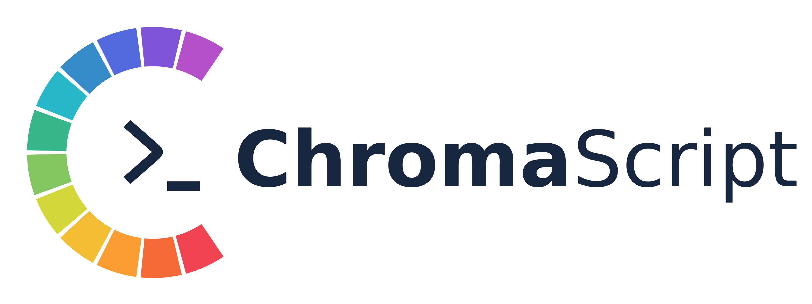
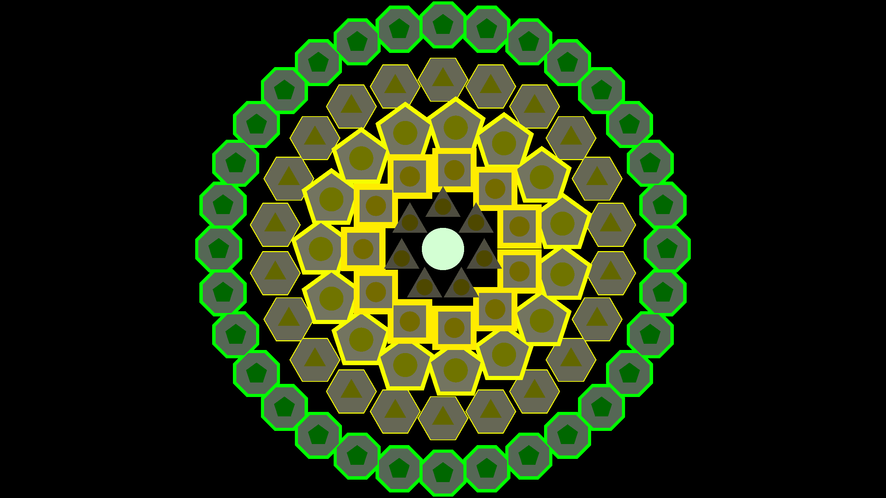

# ChromaScript




An audio-reactive visual runtime. A Lua script declares one or more
shapes whose visual properties are bound to the bass, mid or treble content of
whatever is playing on the system's speakers, and the C++ runtime renders them
in real time with OpenGL.

```lua
circle{ colour = "red",   x = -0.55, radius = bass.amplitude }
circle{ colour = "green", x =  0.0,  radius = mid.amplitude }
circle{ colour = "blue",  x =  0.55, radius = treble.amplitude }
```

## Dependencies

The complete dependency list, reference versions and optional dissertation tools
are documented in [DEPENDENCIES.md] (DEPENDENCIES.md).

The build needs C11 and C++17 compilers, `make`, `pkg-config` and the development
packages for GLFW 3, Lua 5.4, PulseAudio, OpenGL and FFTW. Audio capture uses the
PulseAudio simple API, which on modern distributions is served by PipeWire's
PulseAudio compatibility layer, so the project is Linux-only as it stands.

Debian / Ubuntu:

```sh
sudo apt install build-essential pkg-config libglfw3-dev liblua5.4-dev libpulse-dev libgl-dev libfftw3-dev
```

The glad OpenGL loader is generated code (OpenGL 3.3 core profile)in `third_party/glad/`.
The test framework is in `third_party/doctest/`.
Neither needs a separate installation.

## Building and running

```sh
make        # builds the `dsl` binary
make run    # builds if needed, then runs with scripts/circle.lua
make clean  # removes the binary and the build/ directory
```

To run with your own script:

```sh
./dsl path/to/script.lua
```

Run from the repository root so the runtime can read `config/band_values.cfg`.
Edit that file to change the frequency range used by each audio band, in Hz:

```ini
bass={20, 250}
mid={250, 1500}
treble={1500, 20000}
```

Restart the program to apply changes. All three bands must appear once, with
finite limits satisfying `0 <= low < high <= 24000` (half the 48 kHz sample
rate). Blank lines, whitespace and `#` comments are supported. If the file is
missing or invalid, the runtime reports the problem and uses the default ranges
shown above. Band gains remain unchanged.

The script is watched while the program runs; saving a change reloads it live.
If evaluation fails, the previous valid scene remains active. Supplied numeric
properties must be finite and fit in a float, and fixed radii must be non-negative.

Run the unit tests with `make test`. They use doctest, whose single header is
included in the project, so no test framework installation is needed.
Every test runs by default, including low-register accuracy and noise rejection.
The current analyser limitations cause failures in these checks, so `make test`
currently returns a failing status. See
[tests/doctest/README.md](tests/doctest/README.md) for coverage and instructions.

Named colours use explicit HSV values, including green at 120 degrees, orange
at 30 degrees and yellow at 60 degrees. White, grey and black have fixed
achromatic values. The same chromatic palette supplies the default hue mapping
from pitch classes; general `tone.main` bindings retain their normalised scale.

`make test-sanitise` runs the same complete suite with memory and undefined-behaviour
sanitisers enabled.

## Layout

```
Makefile            build configuration
src/main.cpp        application entry point
src/dsl/            Lua bindings, scene construction and property resolution
src/runtime/audio/  audio capture, feature extraction and band configuration
src/runtime/render/ OpenGL renderer and script reload polling
scripts/            example Lua programs
config/             audio band configuration
tests/doctest/      headless automated tests
third_party/glad/   vendored OpenGL loader (generated by glad2)
third_party/doctest/ vendored test framework
```
